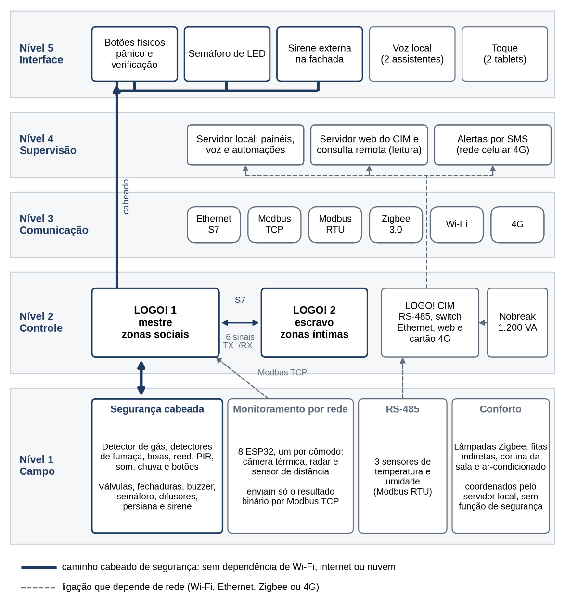
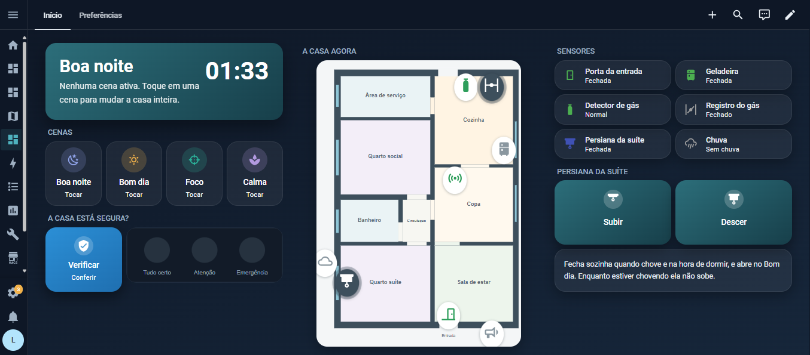

# Projeto de Automação Residencial Integrado ao Projeto Elétrico Para Moradores Neurodivergentes

Projeto de um sistema de automação residencial integrado ao projeto elétrico de uma residência, pensado a partir das necessidades ambientais de pessoas com TDAH, TOC e TEA e das condições associadas de ansiedade e epilepsia. Trabalho de Conclusão de Curso em Engenharia de Controle e Automação na Universidade Federal de Minas Gerais (UFMG), 2026.

## A ideia em uma frase

A segurança da casa nunca depende de tela, aplicativo, internet ou nuvem: ela roda em controladores cabeados, e tudo o que depende de rede é conforto ou acompanhamento.

## Destaques

- **Dois CLPs Siemens LOGO! 8.4** com seis cenas de automação (Sono, Manhã, Foco, Calmante, Emergência e Verificação TOC) e prioridades resolvidas por intertravamento.
- **Segurança cabeada:** corte de gás e água, botões de pânico, sirene externa, semáforo de sinalização e persiana externa com sensor de chuva, sem dependência de rede.
- **Detecção de queda e crise por cômodo** em nós ESP32 com câmera térmica, radar e sensor de distância, processando tudo localmente e sem enviar imagens.
- **Servidor local** com painéis, voz processada dentro da casa e sugestão de rotinas a partir da agenda do morador.
- **Alerta ao cuidador por SMS** pelo canal 4G do módulo de comunicação, independente da internet doméstica.
- **Projeto elétrico completo** conforme a ABNT NBR 5410:2004 e a CEMIG ND-5.1.
- **Lógica verificada em co-simulação** com 30 casos de teste, todos aprovados.

## Navegação

| Pasta | Conteúdo |
|---|---|
| [`docs/`](docs/) | Texto do TCC: volume principal e volume complementar, em PDF |
| [`clp/`](clp/) | Programas dos dois LOGO!, listas de conectores e diagramas FBD |
| [`firmware/`](firmware/) | Firmware dos nós de monitoramento (ESP32, PlatformIO) |
| [`servidor-local/`](servidor-local/) | Configuração do servidor local, da casa real e da simulação, e capturas dos painéis |
| [`testes/`](testes/) | Plano dos 30 casos de teste e capturas do simulador |
| [`eletrico/`](eletrico/) | Desenhos e memória de cálculo do projeto elétrico |
| [`materiais/`](materiais/) | Lista de materiais com cotações de referência |
| [`figuras/`](figuras/) | Todas as figuras do trabalho |

## Arquitetura

| Nível | Função | Componentes |
|---|---|---|
| 5. Interface | Interação com o morador | Botões físicos, semáforo, sirene, voz local e tablets |
| 4. Supervisão | Acompanhamento e conforto | Servidor local, servidor web do CIM e SMS |
| 3. Comunicação | Protocolos | Ethernet, S7, Modbus TCP e RTU, Zigbee, Wi-Fi e 4G |
| 2. Controle | Lógica das cenas e da segurança | LOGO! 1 (mestre) e LOGO! 2 (escravo) |
| 1. Campo | Sensores e atuadores | Detectores, boias, reeds, válvulas, fechaduras, persiana e nós ESP32 |

## Reproduzir sem hardware

Todo o sistema pode ser testado em um notebook comum:

1. Abra os programas da pasta `clp/` no LOGO! Soft Comfort V8.4 e rode a co-simulação dos dois controladores.
2. Siga o roteiro de `testes/README.md` para executar os 30 casos.
3. Para ver os painéis, rode o Home Assistant em máquina virtual com a configuração de `servidor-local/simulacao/`.

## Estado do projeto

O projeto está documentado e a lógica foi verificada em simulação. Ainda dependem de verificação física os sensores reais e o algoritmo de detecção de queda e crise, a instalação elétrica, a atuação de válvulas, fechaduras e motor, o canal 4G e o uso por moradores. Nenhuma alegação de eficácia clínica é feita.

## Licença

[CC BY-NC 4.0](LICENSE.md): uso e adaptação livres com crédito à autora, sem fins comerciais.

## Autora

Leticia Vitória, Engenharia de Controle e Automação, UFMG.
