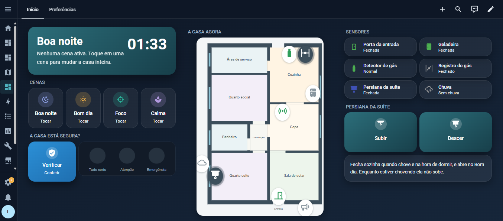
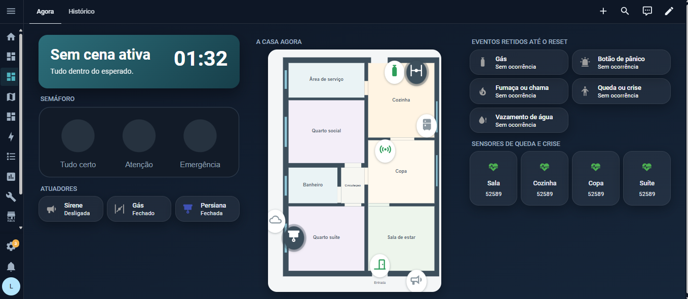
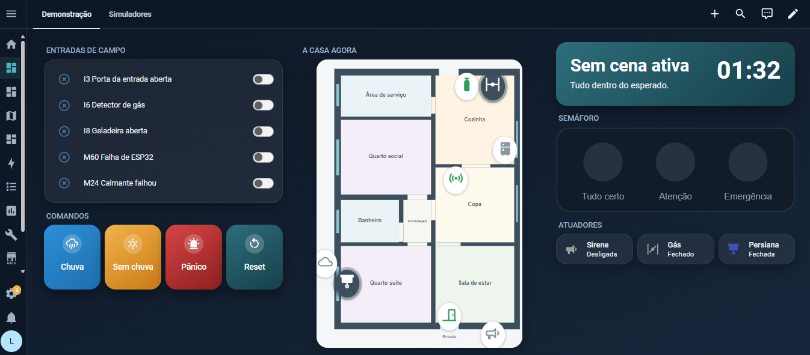
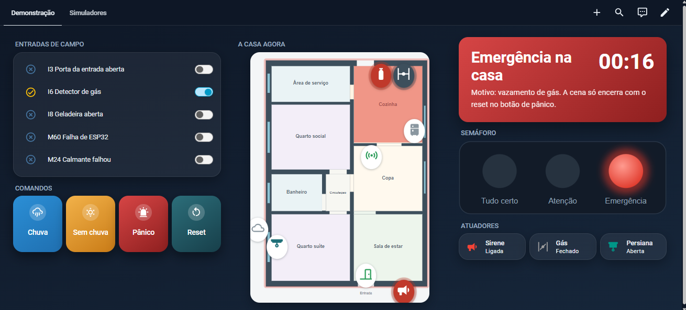

# Servidor local

Mini PC com Home Assistant, responsável pelos painéis de acompanhamento, pela voz local, pelas rotinas de conforto e pela sugestão de rotinas. O servidor lê o estado do LOGO! 1 em modo somente leitura e escreve apenas nos registradores de comando HR130 a HR136. Nenhuma função de segurança depende dele: se ele cair, a casa perde os painéis, a voz e o conforto, e todas as funções cabeadas e o SMS continuam funcionando.

| Pasta | Uso |
|---|---|
| [`casa-real/`](casa-real/) | Configuração da instalação real (LOGO! 1 em 192.168.1.10, porta 503) |
| [`simulacao/`](simulacao/) | Configuração usada para simular o servidor em máquina virtual, sem nenhum equipamento, e os três painéis |
| [`paineis/`](paineis/) | Capturas dos painéis na simulação |

## Painéis

| Painel | Para quem | O que mostra |
|---|---|---|
| Morador | Tablet de parede e celular do morador | Cenas, confirmação do estado da casa, sensores e persiana |
| Acompanhamento | Cuidador | Semáforo, atuadores, eventos retidos até o reset e pulso de vida dos sensores de queda e crise |
| Bancada | Ensaios e demonstração | Entradas de campo simuladas, comandos e resposta do sistema na planta da casa |

Os painéis usam os cartões Mushroom e card-mod, instalados pelo HACS, e o tema `casa_escura`.

## Mapa de endereços usado na configuração

| Recurso do LOGO! | Endereço Modbus |
|---|---|
| Marcador Mn | coil 8255 + n (M10 = 8265, M14 = 8269) |
| Saída Qn | coil 8191 + n (Q1 = 8192, Q13 = 8204) |
| Entrada In | entrada discreta n - 1 (I3 = 2) |
| Pulso de vida dos ESP32, HR120 a HR127 | holding registers 120 a 127 |
| Comandos HR130 a HR136 | holding registers 130 a 136 |

Os sensores reed ficam energizados com a porta fechada (1 = fechada), por isso a configuração inverte a leitura para exibir "aberta" e "fechada" corretamente.
